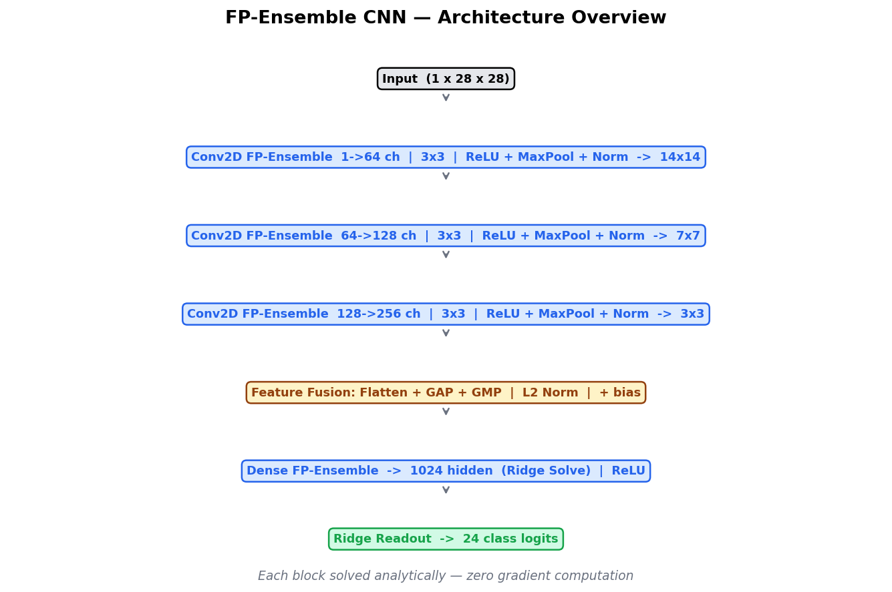

# FP-Ensemble CNN for Sign Language MNIST

Backpropagation-free convolutional architecture using **Ensemble Random Projection Forward Projection (FP-Ensemble)** — trained entirely via closed-form Ridge Regression in a single forward pass.

---

## Table of Contents

- [Overview](#overview)
- [Architecture](#architecture)
- [Results](#results)
- [Dataset](#dataset)
- [Project Structure](#project-structure)
- [Quick Start](#quick-start)
- [Running on Google Colab](#running-on-google-colab)
- [Configuration](#configuration)
- [How It Works](#how-it-works)
- [Requirements](#requirements)
- [Citation](#citation)

---

## Overview

This project implements **Architecture 3: FP-Ensemble CNN** applied to the [Sign Language MNIST](https://www.kaggle.com/datasets/datamunge/sign-language-mnist) dataset.

Key properties:

- **No backpropagation** — each layer is solved analytically via Ridge Regression.
- **Ensemble Random Projections** — R independent random projection pairs fused by weighted averaging for richer target representations.
- **Single-pass training** — the entire network is trained layer-by-layer in one forward pass, completing in 8–15 seconds on a T4 GPU.
- **24-class ASL recognition** excluding dynamic gestures J and Z.

---

## Architecture



```
Input (1 x 28 x 28)
        |
        v
Conv2DFPEnsembleBlock   1 -> 64  ch  |  3x3 kernel  |  ReLU + MaxPool + InstanceNorm  ->  14x14
        |
        v
Conv2DFPEnsembleBlock  64 -> 128 ch  |  3x3 kernel  |  ReLU + MaxPool + InstanceNorm  ->   7x7
        |
        v
Conv2DFPEnsembleBlock 128 -> 256 ch  |  3x3 kernel  |  ReLU + MaxPool + InstanceNorm  ->   3x3
        |
        v
Feature Fusion: Flatten(3x3) + GAP + GMP  |  L2 Normalise  |  + bias column
        |
        v
Dense FP-Ensemble hidden layer  ->  1024 units  (closed-form Ridge)  |  ReLU
        |
        v
Ridge Readout  ->  24-class logits
```

Each block is solved analytically — zero gradient computation at any stage.

The layer weight matrix is computed as:

```
W_l = (A^T A + lambda * I)^{-1} A^T Z_tilde_ensemble
```

where the ensemble target is:

```
Z_tilde_ensemble = sum_{r=1}^{R}  gamma_r * [ sign(A Q^(r))  +  sign(Y U^(r)) ]
```

---

## Results

Experiments averaged over 3 random seeds on a NVIDIA T4 GPU (Google Colab):

| Architecture | R | Train Acc (%) | Test Acc (%) | Test AUC (%) | Target Gen (s) | Total Time (s) |
|---|---|---|---|---|---|---|
| Original FP (R=1) | 1 | 100.00 +/- 0.00 | 95.01 +/- 0.35 | 99.67 +/- 0.07 | 0.13 | 8.76 |
| FP-Ensemble (R=3) | 3 | 100.00 +/- 0.00 | 94.83 +/- 0.85 | 99.83 +/- 0.02 | 0.07 | 10.19 |
| **FP-Ensemble (R=5)** | **5** | **100.00 +/- 0.00** | **96.31 +/- 0.49** | 99.79 +/- 0.08 | 0.10 | 12.42 |
| FP-Ensemble (R=8) | 8 | 100.00 +/- 0.00 | 94.71 +/- 1.12 | 99.76 +/- 0.09 | 0.20 | 15.05 |

R=5 achieves the best test accuracy of **96.31%** while maintaining 99.79% AUC in approximately 12 seconds of training.

### Test Accuracy vs Ensemble Size


### Test AUC vs Ensemble Size


### Training Time vs Ensemble Size


### Accuracy vs Training Time Trade-off


---

## Dataset

**Sign Language MNIST** — 28x28 grayscale images of American Sign Language (ASL) hand gestures.

| Split | Samples | Classes |
|---|---|---|
| Train | 27,455 | 24 (A-Y, excluding J and Z) |
| Test | 7,172 | 24 |

Download: [Sign Language MNIST on Kaggle](https://www.kaggle.com/datasets/datamunge/sign-language-mnist)

Labels J (index 9) and Z (index 25) are excluded because they require motion.

---

## Project Structure

```
FP-Ensemble-SignLanguage-MNIST/
|
|-- src/
|   |-- fp_ensemble_layer.py     # Dense FP-Ensemble layer and MLP
|   `-- fp_ensemble_cnn.py       # Conv2D block and full CNN
|
|-- results/
|   |-- summary.csv              # Experiment results (auto-generated)
|   `-- figures/                 # Result plots (auto-generated)
|
|-- scripts/
|   `-- generate_plots.py        # Regenerate result figures
|
|-- train.py                     # CLI training and evaluation script
|-- FP_Ensemble_SignMNIST.ipynb  # Colab-ready notebook with outputs
|-- requirements.txt
|-- LICENSE
`-- README.md
```

---

## Quick Start

### 1. Install dependencies

```bash
pip install -r requirements.txt
```

### 2. Prepare dataset

Place the Sign Language MNIST folder (or ZIP) at:

```
E:\C_Downloads\Sign Language MNIST\
    sign_mnist_train.csv
    sign_mnist_test.csv
```

If you have the ZIP file, `train.py` will extract it automatically.

### 3. Run training

```bash
python train.py --data_dir "E:/C_Downloads/Sign Language MNIST"
```

Full options:

```bash
python train.py \
  --data_dir "E:/C_Downloads/Sign Language MNIST" \
  --ensemble_sizes 1 3 5 8 \
  --seeds 0 1 2 \
  --lam_conv 5.0 \
  --lam_fc 20.0 \
  --hidden_mlp 1024
```

Results are saved automatically to `results/summary.csv`.

---

## Running on Google Colab

1. Upload `Sign Language MNIST.zip` to `/content/`.
2. Open `FP_Ensemble_SignMNIST.ipynb` in Colab.
3. Set Runtime > Change runtime type > GPU (T4 recommended).
4. Run all cells — training completes in under 15 seconds.

---

## Configuration

| Parameter | Default | Description |
|---|---|---|
| `R` | 5 | Number of ensemble projection pairs per layer |
| `conv_channels` | (64, 128, 256) | Output channels for each conv block |
| `hidden_mlp` | 1024 | Dense hidden layer width |
| `lam_conv` | 5.0 | Ridge regularisation lambda for conv layers |
| `lam_fc` | 20.0 | Ridge regularisation lambda for dense and readout layers |
| `batch_size` | 512 | Mini-batch size for patch accumulation during training |
| `spatial_subsample` | 2 (conv1), 1 (conv2, conv3) | Patch spatial stride used only during training |

---

## How It Works

### Forward Projection

Standard backpropagation requires repeated forward/backward passes over all layers. Forward Projection replaces this with a one-shot closed-form layer training:

1. **Target generation** — construct a target representation for the current layer using random projections of the input activation and the label:

   ```
   Z_tilde = sign(A Q) + sign(Y U)
   ```

2. **Ridge solve** — fit the layer weights analytically in one matrix operation:

   ```
   W = (A^T A + lambda I)^{-1} A^T Z_tilde
   ```

3. **Activation** — apply ReLU and pass the output to the next layer.

### Ensemble Extension

Instead of a single projection pair, R independent pairs are used and their targets are fused:

```
Z_tilde_ensemble = sum_{r=1}^{R}  gamma_r * [ sign(A Q^(r))  +  sign(Y U^(r)) ]
```

With equal fusion weights `gamma_r = 1/R`, this provides richer target representations and improves generalisation, particularly at R=5.

### Convolutional Adaptation

The same principle extends to convolutions by flattening image patches via `torch.nn.functional.unfold` into a 2D matrix, applying the FP-Ensemble solve patch-wise, and reshaping back to feature maps. Post-processing applies 2x2 max-pooling and instance normalisation.

---

## Requirements

```
torch >= 2.0.0
numpy >= 1.24.0
pandas >= 2.0.0
scikit-learn >= 1.3.0
```

A CUDA-capable GPU is strongly recommended. CPU training is significantly slower for the convolutional patch accumulation step.

---

## Citation

If you use this code, please cite:

```bibtex
@misc{fpensemble_signmnist_2026,
  title   = {FP-Ensemble CNN for Sign Language MNIST},
  author  = {R. Ramkumar},
  year    = {2026},
  note    = {Backpropagation-free convolutional architecture using
             Ensemble Random Projection Forward Projection}
}
```

---

## License

MIT License — see [LICENSE](LICENSE) for details.
