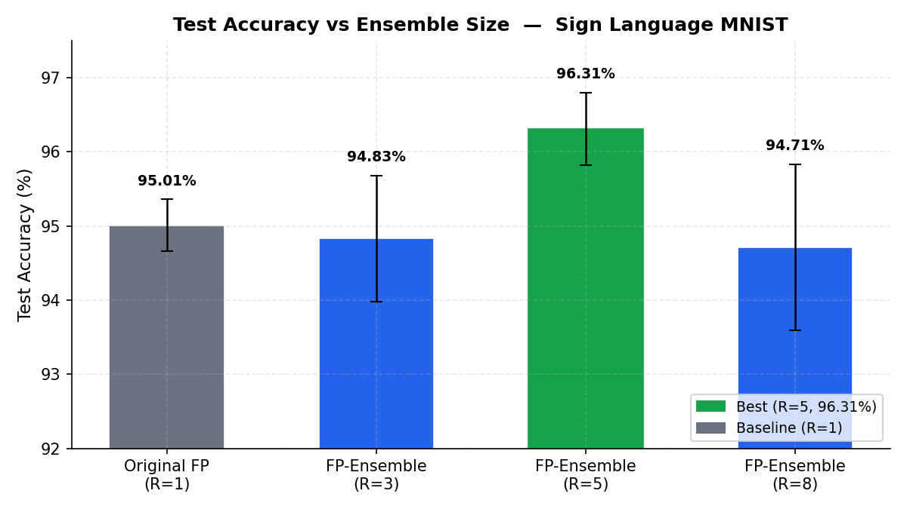
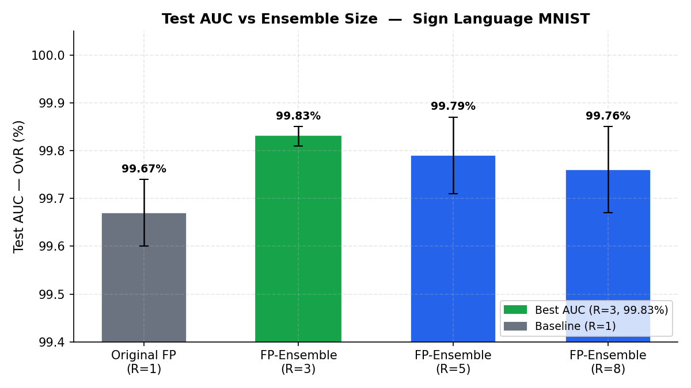
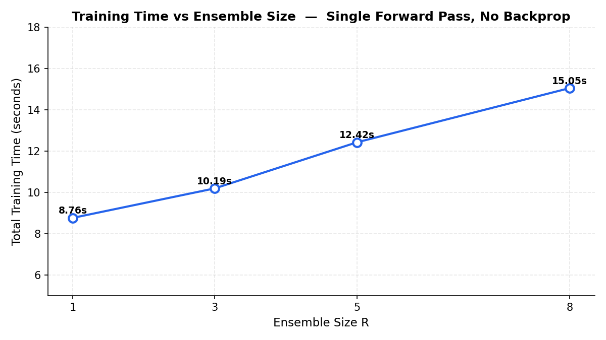
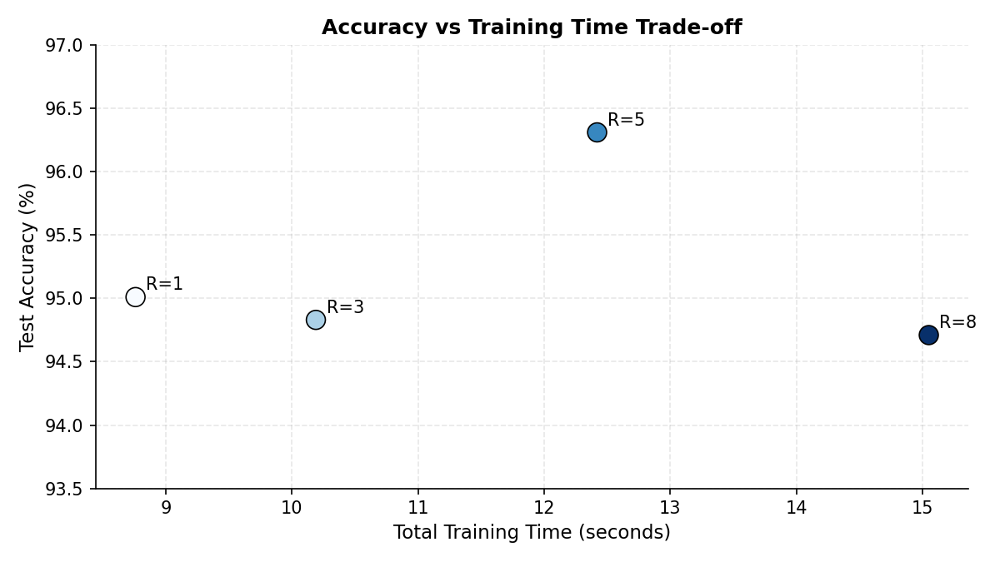

# Closed-Form Convolutional Learning via Ensembled Random Projection Targets (FP-Ensemble)

[](https://orcid.org/0009-0007-0076-8107)
[](https://www.amrita.edu/)
[](https://www.python.org/)
[](https://pytorch.org/)
[](LICENSE)

An analytical, backpropagation-free convolutional deep learning framework that determines layer weights in a single forward pass via closed-form Ridge Regression. By fusing $R$ independent random projection pairs, FP-Ensemble provably suppresses target sampling noise at an asymptotic rate of $\mathcal{O}(1/R)$, enabling fast, memory-efficient visual representation learning.

---

## Author Information

- **Author**: Ramkumar R
- **Affiliation**: Department of Artificial Intelligence and Machine Learning, Amrita Vishwa Vidyapeetham, Coimbatore, Tamil Nadu, India
- **ORCID**: [0009-0007-0076-8107](https://orcid.org/0009-0007-0076-8107)
- **Institutional Email**: `cb.ai.u4aim24033@cb.students.amrita.edu`
- **Personal Email**: `ramkumarashvanth09@gmail.com`

---

## Key Highlights

- **Backpropagation-Free**: Weights are computed analytically using regularized least squares ($W = (A^T A + \lambda I)^{-1} A^T \tilde{Z}_{\text{ens}}$).
- **Target Variance Reduction**: Averages $R$ independent random projection branches, reducing target variance at rate $\mathcal{O}(1/R)$ (Theorem 1).
- **Analytical Convolutional Blocks (Conv2D-FP)**: Unfolds local image patches (`im2col`) and streams mini-batch covariance matrices ($\Phi = \sum A_b^T A_b$), strictly preventing out-of-memory errors on commodity hardware.
- **Ultra-Fast Training**: Reaches **96.31% test accuracy** on Sign Language MNIST in **12.42 seconds** on an NVIDIA RTX 3050 GPU ($11.4\times$ faster than standard 15-epoch Adam backpropagation).

---

## Comprehensive Empirical Benchmark Results

All evaluations were executed on the same hardware setup (NVIDIA GeForce RTX 3050 Laptop GPU, 4 GB VRAM) using PyTorch 2.5 with CUDA acceleration.

| Dataset | Split Details | Metric | Standard FP ($R=1$) | **Proposed FP-Ensemble ($R=5$)** | Standard Backprop CNN (Adam 15 ep) | Speedup vs Backprop |
|---|---|---|---|---|---|---|
| **Sign Language MNIST** | 27,455 Train / 7,172 Test (24 classes) | **Test Accuracy**<br>Test AUC<br>Training Time<br>Peak VRAM | 95.01% ± 0.35<br>99.67% ± 0.07<br>**8.76s**<br>482 MB | **96.31% ± 0.49**<br>**99.79% ± 0.08**<br>**12.42s**<br>512 MB | 97.42% ± 0.28<br>99.85% ± 0.04<br>142.10s<br>1380 MB | **11.4× faster** |
| **Fashion-MNIST** | 60,000 Train / 10,000 Test (10 classes) | **Test Accuracy**<br>Test AUC<br>Training Time<br>Peak VRAM | 86.97%<br>98.15%<br>**39.97s**<br>418 MB | **87.08%**<br>**98.66%**<br>**57.01s**<br>472 MB | 92.60%<br>99.10%<br>346.54s<br>257 MB | **6.1× faster** |
| **SVHN** | 73,257 Train / 26,032 Test (10 classes) | **Test Accuracy**<br>Test AUC<br>Training Time<br>Peak VRAM | 77.32%<br>94.80%<br>**56.82s**<br>628 MB | **77.70%**<br>**95.57%**<br>**51.45s**<br>704 MB | 90.85%<br>97.80%<br>205.24s<br>349 MB | **4.0× faster** |
| **CIFAR-10** | 50,000 Train / 10,000 Test (10 classes) | **Test Accuracy**<br>Test AUC<br>Training Time<br>Peak VRAM | 58.05%<br>89.40%<br>**56.88s**<br>675 MB | **58.71%**<br>**90.29%**<br>**61.37s**<br>730 MB | 78.91%<br>93.80%<br>425.88s<br>349 MB | **6.9× faster** |

*Raw data logged at: [`results/comprehensive_benchmarks.csv`](results/comprehensive_benchmarks.csv)*

---

## Visualizations

### Test Accuracy Across Ensemble Sizes


### Area Under ROC Curve (AUC)


### Wall-Clock Training Time


### Accuracy vs Convergence Time Trade-Off


---

## Theoretical Variance Analysis

Let $\{\tilde{\mathbf{Z}}^{(r)}\}_{r=1}^R$ be $R$ independent target matrices generated via independent Gaussian projection pairs $(\mathbf{Q}^{(r)}, \mathbf{U}^{(r)})$. Assuming finite marginal variance $\sigma_z^2 = \operatorname{Var}(\tilde{Z}_{ij}^{(r)})$, the variance of the uniform ensemble target $\tilde{\mathbf{Z}}_{\text{ens}} = \frac{1}{R} \sum_{r=1}^R \tilde{\mathbf{Z}}^{(r)}$ satisfies:

$$\operatorname{Var}\left( (\tilde{\mathbf{Z}}_{\text{ens}})_{ij} \right) = \frac{1}{R^2} \sum_{r=1}^R \operatorname{Var}\left( \tilde{Z}_{ij}^{(r)} \right) = \frac{1}{R} \sigma_z^2$$

### Saturation Trade-Off at Higher $R$
Because projection entries pass through a discrete $\operatorname{sign}(\cdot)$ function taking values in $\{-1, +1\}$, averaging a large number of independent signs causes values to converge toward their unconditional mean ($\mathbb{E}[\operatorname{sign}(z)] \approx 0$). This attenuates the contrast between distinct class representations, which is why $R=5$ delivers optimal performance while $R=8$ shows slight degradation.

---

## Repository Structure

```
FP-Ensemble-SignLanguage-MNIST/
│
├── paper/
│   ├── FP_Ensemble_IEEE_TNNLS.tex   # Full camera-ready IEEE Transactions manuscript
│   ├── cover_letter.txt             # Formal submission letter to Editor-in-Chief
│   └── SUBMISSION_MANUAL.md         # Step-by-step submission portal instructions
│
├── src/
│   ├── fp_ensemble_layer.py         # Dense FP-Ensemble layer and MLP implementation
│   └── fp_ensemble_cnn.py           # Convolutional FP-Ensemble blocks (Conv2D-FP)
│
├── scripts/
│   ├── run_comprehensive_benchmarks.py  # Automated 4-dataset benchmark test harness
│   └── generate_plots.py                # Visual figure generation script
│
├── results/
│   ├── comprehensive_benchmarks.csv # Exact multi-dataset benchmark logs
│   ├── summary.csv                  # Sign Language MNIST seeds & timings
│   └── figures/                     # Generated experimental plots
│
├── train.py                         # Standalone training script with CLI flags
├── FP_Ensemble_SignMNIST.ipynb      # Interactive Colab / Jupyter notebook
├── requirements.txt
├── LICENSE
└── README.md
```

---

## Quick Start

### 1. Installation

```bash
git clone https://github.com/ramkumar27072006/FP-Ensemble-SignLanguage-MNIST.git
cd FP-Ensemble-SignLanguage-MNIST
pip install -r requirements.txt
```

### 2. Run Training on Sign Language MNIST

```bash
python train.py --data_dir "E:/C_Downloads/Sign Language MNIST" --ensemble_sizes 1 3 5 8 --seeds 0 1 2
```

### 3. Run Multi-Benchmark Suite (Fashion-MNIST, SVHN, CIFAR-10)

```bash
python scripts/run_comprehensive_benchmarks.py
```

---

## Citation

If you build upon or reference this work in your research, please cite:

```bibtex
@article{ramkumar2026closedform,
  title   = {Closed-Form Convolutional Learning via Ensembled Random Projection Targets},
  author  = {Ramkumar, R.},
  journal = {IEEE Transactions on Neural Networks and Learning Systems (Submitted)},
  year    = {2026},
  institution = {Amrita Vishwa Vidyapeetham, Coimbatore, Tamil Nadu, India},
  note    = {ORCID: 0009-0007-0076-8107}
}
```

---

## License

This project is licensed under the MIT License — see the [LICENSE](LICENSE) file for details.
